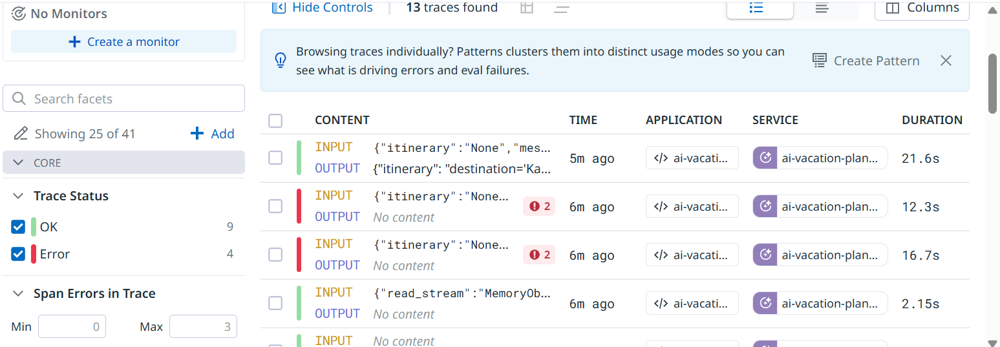
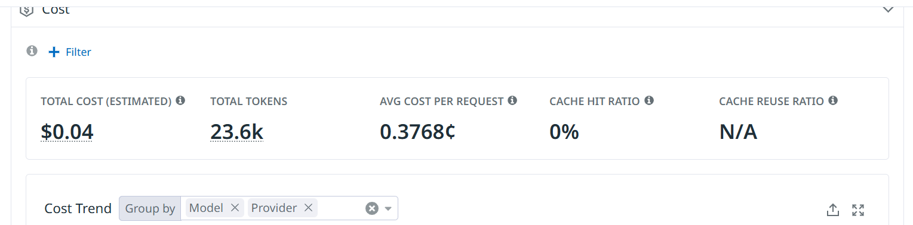

# AI Vacation Planner

An AI-powered trip planning API. Plan a trip by typing it, speaking it, or
letting an AI agent decide for itself which tools it needs — live weather,
place lookups, cost estimates, and a curated travel knowledge base — to
build a real itinerary, and have it read back to you as speech.

The project is built in phases. This version adds the production-readiness
layer: **guardrails, evaluation, automated testing, and observability.**

## What it does

- **Accounts & trips** — register/login (JWT), create and manage trips.
- **AI-generated itineraries** — a tool-using agent plans a day-by-day
  itinerary for a trip, deciding on its own which tools (if any) it needs.
- **Retrieval-Augmented Generation (RAG)** — a curated knowledge base of
  travel guides, local tips, hidden gems, FAQs, and destination notes,
  embedded and searchable by meaning, not just keywords.
- **Voice in, voice out** — speak a trip request and get a planned trip
  back; have any saved itinerary read aloud as natural speech.
- **MCP tools** — weather and place lookups are served by a standalone
  MCP (Model Context Protocol) server, not hardcoded into the agent.
- **Safety** — untrusted input is checked before it reaches a prompt, and
  every generated itinerary is validated before it is saved.
- **Evaluation** — a golden dataset, deterministic checks and an LLM judge
  measure the quality of what the agent produces.
- **Observability** — latency, token usage, model and errors are tracked in
  Datadog.

## Architecture

```
Client
  │
  ├─ POST /itinerary/generate ──┐
  ├─ POST /voice/plan ───────────┤
  │                              ▼
  │                  Input guardrails (src/guardrails/)
  │                    format allowlists · injection rules · LLM classifier
  │                              │
  │                              ▼
  │                        ItineraryService / VoiceService   ◄── Datadog spans
  │                              │
  │                              ▼
  │                     Agent (LangGraph, src/agent/graph.py)
  │                              │   user text is isolated in tags; tool errors
  │                              │   are reported to the model, not raised
  │              ┌───────────────┼───────────────┬──────────────┐
  │              ▼               ▼                ▼              ▼
  │      get_weather        find_place     estimate_trip_cost  search_travel_knowledge
  │      (MCP tool)          (MCP tool)      (local tool)        (local tool, RAG)
  │              │               │                                    │
  │       ┌──────┴───────────────┘                                    ▼
  │       ▼                                                   pgvector similarity
  │  MCP server (src/mcp_server/, stdio subprocess)            search over Voyage AI
  │  wttr.in / Nominatim APIs                                  embeddings of data/knowledge/
  │                              │
  │                              ▼
  │                  Output guardrails (destination, days, order, budget)
  │                    one regeneration on failure, then a clean error
  │                              │
  │                              ▼
  │                      Saved itinerary (trip + itinerary in one transaction)
  │
  └─ GET /itinerary/{id}/audio ─► Claude narration (with plain-text fallback) ─► gTTS ─► audio/mpeg

Offline:  golden dataset → real agent runs (saved) → deterministic checks + DeepEval judge → report
Always:   Datadog LLM Observability records model, latency, tokens and errors for every Claude call
```

### The agent (`src/agent/graph.py`)

Built with **LangGraph** as a small state machine, not a fixed script:

1. **agent** node — calls Claude (`ChatAnthropic`) with all available tools
   bound. Claude decides, per request, whether it needs any tools and
   which ones — there is no hardcoded "always call weather first" logic.
2. **tools** node — runs whichever tool(s) Claude asked for, feeds the
   results back. If a tool fails (a provider outage, a rate limit), the
   model is told the tool is unavailable and plans without it, instead of
   the whole request crashing. The real error goes to the log.
3. Repeats until Claude has enough information, then moves to **finalize**.
4. **finalize** node — forces the final answer into a validated
   `ItinerarySchema` via Claude's structured-output support. Falls back to
   a clean error (never a malformed itinerary) if this fails.

Transient failures (rate limits, timeouts, connection errors) are retried
automatically (`src/agent/retry_handler.py`); non-retryable errors
(billing, bad input) fail fast instead of wasting retries.

The system prompt (`src/agent/prompts.py`) also tells the agent to pace days
realistically (about three to four main activities, never two major museums
in one day) and to say so plainly when a budget is unrealistic for the
destination. Both rules came from evaluation findings (see below).

### RAG — the knowledge base (`src/embeddings/`, `src/services/knowledge_service.py`)

- Source content lives as plain markdown in `data/knowledge/<category>/*.md`.
- `scripts/seed_knowledge_base.py` chunks each file (paragraph-aware,
  sentence-boundary fallback for long paragraphs), embeds each chunk via
  **Voyage AI**, and stores it in Postgres using **pgvector**. Re-running
  it is incremental — unchanged files are skipped via a content hash, so
  it never re-embeds (and re-pays for) content that hasn't changed.
- `KnowledgeService.search()` does the retrieval: embeds the query,
  finds the closest chunks by cosine similarity, and **filters out
  anything below a relevance threshold** — a query with no genuinely
  relevant content returns nothing, rather than the "closest available"
  chunk regardless of how unrelated it actually is.
- As a second line of defense, the agent's system prompt explicitly
  instructs Claude to ignore retrieved content that turns out to be
  about the wrong destination, rather than forcing it into the answer.
- Exposed directly via `GET /knowledge/search` (so retrieval quality can
  be verified independently of generation), and used internally by the
  agent via the `search_travel_knowledge` tool.

### MCP — weather & maps as a separate service (`src/mcp_server/`)

Weather (`wttr.in`) and place lookups (OpenStreetMap/Nominatim) are not
plain functions imported into the agent's process. They're served by a
**standalone MCP server** (`src/mcp_server/server.py`, built with the
official `mcp` SDK's `FastMCP`), launched as a subprocess and reached
over the **stdio transport** — the agent connects to it as an MCP
*client* (via `langchain-mcp-adapters`), the same way an MCP-aware tool
like Claude Code connects to local tool servers.

A provider failure is reported as a real MCP tool error
(`ProviderUnavailableError`), not as a normal-looking answer. A place that
simply isn't found is a normal result ("No location found"), so the agent
can tell "doesn't exist" from "service is down".

Since MCP's client is async-only and the rest of this codebase is
synchronous, `src/agent/graph.py` bridges the two with a small,
self-contained helper (`_run_async`) that runs the async MCP work on a
dedicated thread — safe regardless of whether the caller already has its
own event loop running. The `/voice/plan` route is a plain `def` route, so
FastAPI runs its blocking work (Whisper, Claude, DB) in a threadpool and
other requests are not held up.

### Voice (`src/agent/voice/`)

- **Speech-to-text**: `POST /voice/plan` accepts an uploaded audio file,
  transcribes it locally with **Whisper** (`faster-whisper`, no API key,
  runs on-device), extracts structured trip details from the transcript
  via Claude, then runs it through the exact same trip/itinerary pipeline
  as the text-based flow — voice is just a second front door, not a
  separate code path. Spoken preferences ("no museums") are passed to the
  agent, the trip and itinerary are saved in a single transaction (a
  failure leaves nothing behind), and the response lists which fields
  (budget, style) were assumed because the speaker didn't mention them.
- **Text-to-speech**: `GET /itinerary/{trip_id}/audio` reads an
  already-generated itinerary and returns it as spoken audio
  (`audio/mpeg`), decoupled from generation itself so any saved
  itinerary can be replayed later regardless of how it was created.
  Claude rewrites the itinerary into a short, natural spoken summary;
  if Claude is unavailable, it falls back to a plain structured summary
  instead of failing outright. Output is capped to a safe length before
  synthesis, since gTTS makes one network request per ~100 characters
  and uncapped text could otherwise take minutes to synthesize.

## Security and guardrails (`src/guardrails/`)

No single check stops prompt injection, so the defence is layered. Each
layer is useful on its own, and none is claimed to be a guarantee.

| Layer | What it does | Where |
|---|---|---|
| **Least privilege** | The agent only has read-only tools, and an allowlist drops any other tool an MCP server might expose. Even a successful injection cannot book, pay or message anyone. | `graph.py` (`ALLOWED_MCP_TOOLS`) |
| **Format allowlists** | `destination` and `trip_style` may only contain letters, spaces and basic punctuation, so newlines, braces and SQL fragments are rejected. This needs no keyword list. | `input_guard.py`, `TripCreate` |
| **Injection rules** | Cheap keyword/regex rules reject well-known override phrases ("ignore previous instructions", fake `<system>` tags), after normalising Unicode tricks such as zero-width and full-width characters. | `input_guard.py` |
| **Unsupported actions** | Requests to book, pay, buy, email or delete are refused with a clear message: the planner only plans itineraries. | `input_guard.py` |
| **LLM classifier** | For free text (the voice transcript), Claude judges whether it is a genuine trip request or an attempt to manipulate the assistant, in any language. It runs after the rules, and if the check itself fails the request is rejected (fail closed). | `injection_classifier.py` |
| **Prompt isolation** | User values are wrapped in tags (`<trip_details>`, `<traveler_preferences>`), angle brackets are stripped so text cannot close a tag early, and the system prompt says tagged text is data, never instructions. | `prompt_isolation.py`, `prompts.py` |
| **Output validation** | A generated plan must match its trip: destination, number of days, day order, and a total cost no more than 2× the budget. A bad plan is regenerated once; a second failure returns a generic error and nothing is saved. | `output_guard.py` |
| **Structured output** | The final answer must parse into `ItinerarySchema`, so malformed output is never stored. | `schemas/itinerary_schema.py` |

The input checks sit in `TripCreate` and the voice extraction step, so they
cover the REST routes and the voice flow alike. Rejected input returns 422
(REST) or 400 (voice), and the log records the field that was rejected, not
its content.

**Known limitations**

- Keyword rules cannot be exhaustive: a paraphrased or translated attack
  slips past them. That is why the classifier exists, and why two of the
  golden-dataset attacks are labelled as needing it.
- The classifier is probabilistic and costs one extra Claude call per voice
  request. It can be switched off with `INJECTION_CLASSIFIER_ENABLED=false`.
- The "book / buy / pay" rule cannot tell an action from a preference, so a
  phrase like "book a hotel with a pool" is refused. This favours a clear
  refusal over letting the agent act on it.
- Rate limiting and per-user quotas are not implemented.

## Evaluation (`src/evaluation/`, `tests/evals/`)

### Approach

Quality is measured in two complementary ways, on the same set of cases:

1. **Deterministic checks** (free, repeatable) cover everything that can be
   checked in code, mapped to the four qualities the assignment names:

   | Quality | Check |
   |---|---|
   | **Valid** | The output parses into `ItinerarySchema`. |
   | **Relevant** | Destination, number of days, day order and budget match the trip; forbidden content (for example "museum" when the user said "no museums") is absent. |
   | **Complete** | Every day has a theme and every activity has a description. |
   | **Format** | Costs are numbers, or wording such as "Free" or "Included in activity cost". |

2. **LLM judge** (DeepEval `GEval`, Claude as the judge) scores what code
   cannot: is the plan sensible? Three metrics, each scored 0 to 1 with a
   pass mark of 0.7: *Relevance to the request*, *Completeness and
   coherence* (including realistic pacing), and *Meets the case criteria*
   (compared with a plain-English expectation written for each case).

The agent is run **once** and its outputs are saved; the judges then read
the saved file. This keeps iteration cheap, because re-judging never
re-runs the agent.

### Golden dataset (`tests/evals/golden_dataset.json`)

16 cases, each with the trip, optional preferences, the expected outcome
and a written criterion:

| Group | Cases | Purpose |
|---|---|---|
| Standard (5) | Lisbon, Rome in one day, low-budget Bangkok, luxury Paris, adventure Queenstown | Typical trips, style and budget |
| Edge (2) | 7-day Tokyo, remote Tristan da Cunha | Completeness and honesty about remote places |
| Preferences (2) | "no museums", "travelling with a toddler" | Stated wishes are honoured |
| Attacks the rules block (5) | Instruction override in preferences, destination and style; "book me a flight"; 45 days | Rejected before reaching the model |
| Attacks only the classifier catches (2) | A paraphrased override and a French one | The known gap in keyword rules |

Offline tests verify that every legitimate case passes the guardrails (no
false positives), that every blocked attack is rejected, and that the two
paraphrased attacks do slip past the rules, which documents the gap.

### Results and what we learned

| Stage | Free checks | Judge checks |
|---|---|---|
| First run | 7 of 9 | blocked by a configuration error |
| After fixing our own check | 9 of 9 | 4 of 9 |
| After prompt and rubric changes | 9 of 9 | 8 of 9 |

Reading the judge's reasons for each failure, rather than just the scores,
separated agent problems from evaluation problems:

- **A bug in our own check.** The cost check rejected "Free (optional
  donations)" and "Included in activity cost". Fixed in the check.
- **A real agent weakness.** Two plans (luxury Paris, adventure Queenstown)
  packed too much into a day. Fixed by the pacing rule in the system prompt.
- **Three rubric problems.** The judge penalised spending less than the
  budget, treated ruins and churches as "museums", and marked down a plan
  that honestly said a $1,500 budget cannot reach a remote island. The
  judge's steps were clarified for each.
- **One remaining failure.** The Tristan da Cunha case still scores 0.5 to
  0.6 on completeness. A two-day trip to a remote island on $1,500 is an
  impossible request; the agent says so, and the judge then marks the plan
  down for being unrealistic. It is left as a known borderline case rather
  than tuned until it passes.

**Caveats, stated plainly**

- The prompt and the rubric were changed together, so the improvement from
  4 to 8 judged cases cannot be attributed to either one alone. Judging the
  earlier saved run with the new rubric (`EVAL_OUTPUTS`, below) separates
  them.
- Changing the rubric after seeing results is calibration, and is disclosed
  here for that reason.
- The judge is noisy: the same plan scored 0.6 and then 0.5. A single run
  is a sample, and cases near the pass mark can flip.
- The judge defaults to the same model family as the agent
  (`claude-haiku-4-5`), which tends to be lenient. A different or stronger
  judge, and a human check on a handful of cases, would be better.
- 16 cases is a smoke test, not a benchmark.

### Running the evaluation

```bash
# 1. Run the real agent on the golden dataset and save the plans
python scripts/generate_eval_outputs.py            # all cases (waits between cases)
python scripts/generate_eval_outputs.py rome       # only ids containing "rome"

# 2. Judge the saved plans and print every score
python -m pytest -m eval -v -k "not classifier" --tb=line

# 3. Live check of the injection classifier on the paraphrased attacks
python -m pytest -m eval -v -k classifier

# Judge an earlier saved run instead (for before/after comparisons)
$env:EVAL_OUTPUTS="tests/evals/results/outputs_before.json"   # PowerShell
```

Step 2 prints a score table and writes `tests/evals/results/judge_report.md`
with every score, the judge's reason and the plan that was judged. The
generation script waits 45 seconds between cases (`--pause`), because
Voyage's free tier allows only three searches a minute.

## Testing

All automated tests run **offline**: Claude, Whisper and gTTS are mocked,
and the database is in-memory SQLite, so the suite is fast, free and
deterministic. Live evaluation is separate, marked `eval`, and excluded
from normal runs.

```bash
python -m pytest -q                 # offline suite (200 tests)
python -m pytest -m eval -v         # live evaluation (calls Claude, costs money)
```

| Layer | Location | Covers |
|---|---|---|
| **API endpoints** | `tests/api/` | Auth, trips (ownership and validation), itinerary generation and audio, voice, and that every route is documented in Swagger. Real password hashing and real JWTs; only the AI services are mocked. |
| **Generation flow** | `test_voice_service.py`, `test_output_guard.py`, `api/test_itinerary.py` | Preferences reach the agent, trip and itinerary save atomically, a bad plan is regenerated once and never saved. |
| **Structured output validation** | `test_output_guard.py`, `test_eval_checks.py` | Schema, destination, day count and order, budget. |
| **Guardrails** | `test_input_guard.py`, `test_injection_classifier.py`, `test_guardrails_wiring.py` | Attacks blocked and honest requests allowed, prompt isolation, the tool allowlist. |
| **AI evaluation** | `tests/evals/` | Golden dataset integrity, deterministic checks, report formatting offline; the DeepEval judge and classifier live. |
| **Resilience** | `test_mcp_tools.py`, `test_mcp_server_boundary.py`, `test_tool_failures.py`, `test_voice_nonblocking.py` | Provider failures become tool errors, a failing tool does not crash a request, a slow voice request does not block others. |
| **Observability** | `test_observability.py` | Datadog is off by default, never breaks a request, and never captures arguments. |

Several tests were checked by deliberately breaking the code under test
(removing the ownership check, the output guard, the tool-error handler)
to confirm the tests fail when they should.

## Observability (Datadog)

Datadog **LLM Observability** runs in agentless mode (data goes straight to
Datadog; no local agent). It is off by default, so the app and the tests run
without it.

- **LLM call tracking**: every Claude call is recorded as an LLM span with its
  model, latency, token usage, estimated cost and any error.
- **Request spans**: itinerary generation (`generate_itinerary`) and voice
  planning (`plan_trip_from_voice`) are traced with their duration, and an
  exception shows up as a failed request.
- **Safe by design**: function arguments are not captured (they include user
  records and database sessions), and the test suite forces Datadog off
  whatever `.env` says. A missing key or an unreachable Datadog never
  affects a request.

```
DATADOG_ENABLED=true
DD_API_KEY=<API key from Datadog > Organization Settings > API Keys>
DD_SITE=datadoghq.com
```

Check the setup without exposing the key:

```bash
python scripts/check_datadog.py             # key shape and whether Datadog accepts it
python scripts/send_datadog_test_trace.py   # sends one test trace
```

Then open **LLM Observability > Traces** in Datadog (not APM). Prompts and
answers of the Claude calls are stored by Datadog, which includes trip
details and plans; review that before using real user data.

### Token usage and cost

Every Claude call the agent makes is counted, including retries and
regenerations, so the figure is the true cost of one itinerary. The app:

- records **each Claude call as its own Datadog LLM span** (model, provider,
  input and output tokens, and cost). These are the spans Datadog's **Cost**
  and token views are built from. A call that fails still closes its span,
  with the error.
- **logs** one line per generation: `LLM usage for trip 5: model=... calls=4 input_tokens=... output_tokens=... estimated_cost=$0.0xxx`
- attaches the same summary as readable metadata to the `generate_itinerary`
  span. This also happens when generation fails, because a failed request
  still spends tokens.

Datadog's automatic LangChain and Anthropic spans are switched off, because
they would record each call a second time and double the totals on the Cost
page.

The evaluation script records the same numbers for every golden case and
prints the total and the average cost per itinerary when it finishes:

```bash
python scripts/generate_eval_outputs.py
# ... Estimated cost: $0.0xxx in total, $0.0xxx per generated itinerary
```

The cost is an **estimate**: tokens multiplied by the prices in
`src/observability/usage.py` (`PRICES_PER_MILLION`, currently only
`claude-haiku-4-5` at $1 per million input tokens and $5 per million output
tokens). Check them against the provider's pricing page, and add a line for
any other model you switch to. A model that is not in the table is reported
with tokens and no cost, never a guessed cost.

Scope: this counts the itinerary agent, which is where nearly all the tokens
go. The smaller Claude calls (trip extraction from speech, the injection
classifier, narration) and the evaluation judge are not included.

### Screenshots

Traces from LLM Observability, with each request's duration and its status
(OK or error), which shows latency and failed requests:



The Cost view, built from the per-call LLM spans: total estimated cost, total
tokens and the average cost per request, grouped by model and provider:



## Project structure

```
src/
  main.py                  FastAPI app
  config.py                Settings (env-driven)
  database.py               DB engine/session
  models/                  SQLModel tables + request/response schemas
  routers/                 HTTP endpoints (auth, trips, itinerary, knowledge, voice)
  services/                Business logic (one service per domain concept)
  schemas/                 LLM output validation (ItinerarySchema)
  guardrails/              Input guards, injection classifier, prompt isolation, output guard
  evaluation/              Deterministic quality checks and report helpers
  observability/           Datadog setup, tracing decorator, token usage and cost
  agent/                   The AI agent
    graph.py                LangGraph state machine + MCP client wiring
    prompts.py               Agent system prompt
    retry_handler.py          Shared retry logic
    tools/                    Local LangChain tools (pricing, knowledge/RAG)
    voice/                    Whisper STT, gTTS TTS, Claude narration/extraction
  mcp_server/              Standalone MCP server (weather, maps)
  embeddings/              Chunking + Voyage AI embedding client
  utils/                   Auth, dependencies, background tasks
scripts/
  seed_knowledge_base.py       Ingests data/knowledge/ into the vector DB
  generate_eval_outputs.py     Runs the real agent on the golden dataset
  check_datadog.py             Validates the Datadog key and site
  send_datadog_test_trace.py   Sends one test trace to Datadog
tests/
  api/                     Endpoint tests
  evals/                   Golden dataset, DeepEval suite, report formatting
  ...                      Unit tests for guardrails, services, tools
data/knowledge/            Source travel content (markdown, by category)
migrations/                Alembic database migrations
```

## API

Full interactive docs at `/docs` (Swagger) once running. Endpoints:

| Method | Path | Description |
|---|---|---|
| POST | `/auth/register` | Create an account |
| POST | `/auth/login` | Get a bearer token |
| GET | `/users/me` | Current user |
| POST | `/trips` | Create a trip |
| GET | `/trips` | List your trips |
| GET | `/trips/{trip_id}` | Get a trip |
| PUT | `/trips/{trip_id}` | Update a trip |
| DELETE | `/trips/{trip_id}` | Delete a trip |
| POST | `/itinerary` | Manually create an itinerary |
| POST | `/itinerary/generate` | Generate an itinerary via the AI agent |
| GET | `/itinerary/{trip_id}` | Get a trip's itinerary |
| GET | `/itinerary/{trip_id}/audio` | Hear the itinerary as spoken audio |
| GET | `/knowledge/search` | Semantic search over the travel knowledge base |
| POST | `/voice/plan` | Speak a trip request, get a planned trip back |

Common error responses: **400** (duplicate itinerary, rejected spoken
request or unsupported action), **401** (missing or invalid token),
**403** (not your trip), **404** (not found), **422** (validation, including
rejected trip fields), **500** (generation failed; details are logged, never
returned).

## LLM integration details

- **Provider**: Anthropic Claude, via `langchain-anthropic`. Model is
  configurable (`ANTHROPIC_MODEL` in `.env`, default `claude-haiku-4-5`)
  rather than hardcoded.
- **Structured output**: itinerary generation, trip-detail extraction
  from speech, the injection classifier verdict, and knowledge-base chunk
  schemas all use Claude's native structured-output support
  (`with_structured_output`) to guarantee valid, parseable results instead
  of hand-parsing free text.
- **Tool orchestration**: LangGraph, with four tools available to the
  agent — two served over MCP (weather, maps), two local (pricing
  heuristic, RAG knowledge search).
- **Embeddings**: Voyage AI (`voyage-3.5-lite` by default), used for both
  the knowledge base (document embeddings) and search queries
  (asymmetric query embeddings, per Voyage's recommended approach).
- **Speech**: Whisper (local, via `faster-whisper`) for transcription;
  gTTS for synthesis; Claude for rewriting itineraries into natural
  spoken narration, with a non-AI fallback if Claude is unavailable.
- **Evaluation judge**: DeepEval's `AnthropicModel`, configurable with
  `EVAL_JUDGE_MODEL`.
- **Observability**: Datadog LLM Observability (`ddtrace`).

## Setup

1. **Install dependencies**
   ```bash
   python -m venv .venv
   .venv\Scripts\activate
   pip install -r requirements.txt
   ```

2. **Configure environment** — copy `.env.example` to `.env` and fill in:
   - `DATABASE_URL` — a running PostgreSQL instance with the
     [pgvector](https://github.com/pgvector/pgvector) extension available
   - `SECRET_KEY` — any random string, used to sign JWTs
   - `ANTHROPIC_API_KEY` — required for itinerary generation, voice
     extraction/narration, the injection classifier and the evaluation judge
   - `VOYAGE_API_KEY` — required for the knowledge base (embeddings)
   - Optional: `INJECTION_CLASSIFIER_ENABLED`, `EVAL_JUDGE_MODEL`, and the
     `DATADOG_*` / `DD_*` settings described above

3. **Run database migrations**
   ```bash
   alembic upgrade head
   ```

4. **Seed the knowledge base** (populates the RAG content)
   ```bash
   python scripts/seed_knowledge_base.py
   ```

5. **Start the server**
   ```bash
   uvicorn src.main:app --reload
   ```
   Then open `http://127.0.0.1:8000/docs`.

   The MCP server (`src/mcp_server/server.py`) does **not** need to be
   started separately — the agent launches it automatically as a
   subprocess whenever it needs weather or maps.

6. **Run the tests**
   ```bash
   python -m pytest -q
   ```

### Notes

- The first voice request downloads the Whisper model (one-time, a few
  hundred MB depending on `WHISPER_MODEL`) and needs enough free RAM to
  load it — a few hundred MB free is normally sufficient.
- Weather/maps use free, keyless public APIs (wttr.in, OpenStreetMap
  Nominatim) — no extra setup needed for those two.
- Voyage's free tier allows three requests per minute, and an itinerary
  makes about two knowledge searches. When the limit is hit, the search
  fails softly and the agent plans without it.
